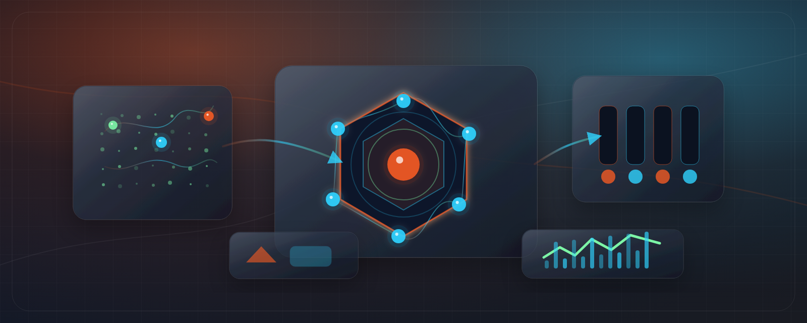

# Awesome Agent Infrastructure   

A curated list of infrastructure for building reliable LLM agents — frameworks, memory, tool protocols, sandboxes, browsers, observability, and retrieval.

Maintained by [Backblaze](https://www.backblaze.com).

### Related Lists

- [Awesome ML Data Pipelines](https://github.com/backblaze-labs/awesome-ml-data-pipelines)
- [Awesome Multimodal Data](https://github.com/backblaze-labs/awesome-multimodal-data)
- [Awesome Physical AI](https://github.com/backblaze-labs/awesome-physical-ai)
- [Awesome Image Generation](https://github.com/backblaze-labs/awesome-image-generation)
- [Awesome Video Generation](https://github.com/backblaze-labs/awesome-video-generation)
- [Awesome Audio Generation](https://github.com/backblaze-labs/awesome-audio-generation)

## Contents

- [Agent Frameworks](#agent-frameworks)
- [Memory and State](#memory-and-state)
- [Tool Protocols and Servers](#tool-protocols-and-servers)
- [Execution Sandboxes](#execution-sandboxes)
- [Browser and Computer Use](#browser-and-computer-use)
- [Observability and Evaluation](#observability-and-evaluation)
- [Guardrails and Governance](#guardrails-and-governance)
- [Retrieval and RAG](#retrieval-and-rag)
- [Vector Databases](#vector-databases)
- [Templates and Example Projects](#templates-and-example-projects)

---

## Agent Frameworks

> Libraries for building LLM agents — planning, tool use, multi-agent orchestration.

- **[Microsoft AutoGen](https://microsoft.github.io/autogen/)** – Multi-agent conversation framework from Microsoft Research. AutoGen 0.4 rewrote it around an event-driven runtime. [Docs](https://microsoft.github.io/autogen/stable/) | SDK: Python
- **[CrewAI](https://www.crewai.com)** – Role-based multi-agent framework. Agents, tasks, and tools composed into crews with deterministic or planning-based flows. [Docs](https://docs.crewai.com) | SDK: Python
- **[Agno](https://www.agno.com)** – Lightweight Python framework for building multimodal agents and agentic systems. Formerly Phidata. [Docs](https://docs.agno.com) | SDK: Python
- **[LangGraph](https://langchain-ai.github.io/langgraph/)** – Graph-based agent runtime from the LangChain team. Durable execution, human-in-the-loop, and multi-actor patterns. [Docs](https://langchain-ai.github.io/langgraph/tutorials/introduction/) | SDK: Python, JavaScript
- **[HuggingFace smolagents](https://huggingface.co/docs/smolagents)** – Minimal "code agent" library — agents write Python to solve tasks. ~1k LoC core; easy to audit and extend. [Docs](https://github.com/huggingface/smolagents) | SDK: Python
- **[Mastra](https://mastra.ai)** – TypeScript-first agent framework with workflows, RAG, and evals. From the creators of Gatsby. [Docs](https://mastra.ai/docs) | SDK: TypeScript
- **[OpenAI Agents SDK](https://openai.github.io/openai-agents-python/)** – Official OpenAI agent framework. Handoffs, guardrails, built-in tracing, and Responses-API-native execution. [Docs](https://github.com/openai/openai-agents-python) | SDK: Python
- **[Pydantic AI](https://ai.pydantic.dev)** – Agent framework from the Pydantic team. Type-safe tool calling, structured outputs, dependency injection. [Docs](https://ai.pydantic.dev) | SDK: Python
- **[AG2](https://ag2.ai)** – Community-maintained fork of AutoGen 0.2. Multi-agent conversation framework with swarms, group chats, and nested chat patterns. [Docs](https://docs.ag2.ai/) | SDK: Python
- **[Agent Swarm](https://www.agent-swarm.dev)** – Self-hosted runtime where a lead agent turns goals into tasks and routes them to workers in isolated containers with shared memory and review gates. [Docs](https://docs.agent-swarm.dev)
- **[AgentScope](https://agentscope.io)** – Python agent framework with an event-driven runtime, human-in-the-loop, sandboxed tool execution, and Agent-as-a-Service REST deployment. v2.0 released May 2026. [Docs](https://docs.agentscope.io) | SDK: Python
- **[DeerFlow](https://github.com/bytedance/deer-flow)** – ByteDance's open-source super-agent harness built on LangGraph. Orchestrates sub-agents, memory, sandboxes, and skills for long-horizon tasks. [Docs](https://github.com/bytedance/deer-flow/blob/main/README.md)
- **[Elflodge](https://elflodge.com)** – Self-hosted runtime for batch automation with unattended Pi agents. Runs parallel jobs in sandboxes without a dedicated container per job, with a job API, structured results, and durable recovery. [Docs](https://github.com/elflodge/elflodge#readme)
- **[Flowise](https://flowiseai.com)** – Open-source visual builder for LLM agents and workflows. Drag-and-drop Agentflow canvas plus REST API, JS/Python SDK, and CLI for programmatic integration into production applications. [Docs](https://docs.flowiseai.com) | SDK: TypeScript
- **[Google ADK](https://adk.dev)** – Google's open-source agent development kit. Build, evaluate, and deploy multi-agent systems; multi-language with Gemini-optimized but model-agnostic. [Docs](https://adk.dev) | SDK: Python, TypeScript
- **[Kodama](https://github.com/optimiware/kodema)** – API-first, multi-tenant software factory in Go running container pipelines and AI coding agents (Claude Code, OpenCode, Codex, Pi) on rootless Podman 5 or Kubernetes Jobs, with PostgreSQL RLS, NATS JetStream, REST/MCP edges, a model gateway, Git access rules, and role inbox approvals. [Docs](https://github.com/optimiware/kodema/blob/master/docs/README.md)
- **[Langflow](https://www.langflow.org)** – Low-code builder for AI agents and RAG applications. Visual canvas with Python escape hatches, deploys flows as REST APIs or MCP servers; 40+ model and vector-store integrations. [Docs](https://docs.langflow.org) | SDK: Python
- **[Langroid](https://langroid.github.io/langroid/)** – Lightweight Python multi-agent framework from CMU/UW-Madison. Task-delegation via message passing; no LangChain dependency. [Docs](https://langroid.github.io/langroid/) | SDK: Python
- **[LazyMind](https://github.com/LazyAGI/LazyMind)** – Open-source AI Skill Runtime that turns reusable Skills into observable, stateful workflows with approval checkpoints, retry and rewind controls, and editable artifacts. [Docs](https://github.com/LazyAGI/LazyMind/blob/main/docs/quick_start.md)
- **[MetaGPT](https://github.com/FoundationAgents/MetaGPT)** – Multi-agent framework that assigns software-company roles (PM, architect, engineer) to LLMs. Input a requirement, get PRD, design, code, and tests. [Docs](https://docs.deepwisdom.ai/main/en/) | SDK: Python
- **[Microsoft Agent Framework](https://devblogs.microsoft.com/agent-framework/)** – Microsoft's production-ready open-source agent SDK and runtime for Python and .NET. Unifies AutoGen orchestration and Semantic Kernel foundations. [Docs](https://learn.microsoft.com/en-us/agent-framework/overview/) | SDK: Python, .NET
- **[Open Agent API](https://github.com/jiangxingfan1-coder/Open-Agent-API)** – Self-hosted agent runtime and gateway for publishing built-in or ACP-connected agents behind OpenAI, Anthropic, and Gemini SDK-compatible endpoints. [Docs](https://github.com/jiangxingfan1-coder/Open-Agent-API#running-in-three-minutes)
- **[Open Multi-Agent](https://github.com/open-multi-agent/open-multi-agent)** – TypeScript-native multi-agent orchestration that plans task DAGs from goals at runtime and runs them with approval gates, tracing, evaluation, checkpoints, and resume support in your own environment. SDK: TypeScript
- **[OpenAI Agents SDK (TypeScript)](https://openai.github.io/openai-agents-js/)** – Official OpenAI agent framework for TypeScript and JavaScript. Agents, handoffs, guardrails, voice via Realtime API, and built-in tracing. [Docs](https://openai.github.io/openai-agents-js/) | SDK: TypeScript
- **[OpenSRE](https://github.com/Tracer-Cloud/opensre)** – Open-source toolkit for building AI SRE agents. Connects to 60+ observability, cloud, and incident-management tools; auto-fetches alert context, correlates logs/metrics, and generates root-cause reports.
- **[Semantic Kernel](https://learn.microsoft.com/en-us/semantic-kernel/overview/)** – Microsoft's open-source SDK for building LLM agents and multi-agent systems. Model-agnostic; plugins, planners, and process orchestration across Python, C#, and Java. [Docs](https://learn.microsoft.com/en-us/semantic-kernel/) | SDK: Python, C#, Java
- **[Strands Agents](https://strandsagents.com)** – AWS-backed open-source agent SDK. Define tools as functions; the model-driven loop handles planning and execution with no workflow graphs required. [Docs](https://strandsagents.com/latest/) | SDK: Python, TypeScript
- **[VoltAgent](https://voltagent.dev)** – TypeScript agent framework with memory adapters, RAG, tool registry, multi-agent supervisor coordination, voice support, and built-in evals. [Docs](https://voltagent.dev/docs/) | SDK: TypeScript

## Memory and State

> Long-term memory, session state, and knowledge-retention layers for agents.

- **[Mem0](https://mem0.ai)** – Memory layer for AI agents. Personalization through user/agent/session memories with semantic recall. [Docs](https://docs.mem0.ai) | SDK: Python, Node
- **[Letta](https://www.letta.com)** – Open-source agent server focused on long-term memory. Successor to MemGPT; agents are first-class stateful services. [Docs](https://docs.letta.com) | SDK: Python
- **[Zep](https://www.getzep.com)** – Memory and context platform for LLM apps. Knowledge-graph-backed user memory with temporal reasoning. [Docs](https://help.getzep.com)
- **[Agent Commons](https://github.com/MrRex168/agent-commons)** – Open-source continuity layer for persistent AI agents. Preserves identity, memory, state, and relationships across model, runtime, and server changes, with signed portable state, A2A discovery, and MCP/REST interfaces. [Docs](https://github.com/MrRex168/agent-commons#readme)
- **[Axonio](https://axonio.xyz/)** – Persistent memory for AI agents with vector and graph retrieval, Git-style memory branching, and hosted MCP access. [Docs](https://docs.axonio.xyz/) | SDK: TypeScript
- **[ClickHouse Loom](https://github.com/ClickHouse/loom)** – Self-hosted MCP server and HTTP API that gives agents shared long-term memory, document search with citations and a code index, stored in ClickHouse. [Docs](https://clickhouse.github.io/loom/) | SDK: Python, TypeScript
- **[Cognee](https://www.cognee.ai)** – Knowledge engine for agent memory. ECL pipeline ingests any data into a hybrid vector + knowledge graph for structured, traceable recall. [Docs](https://docs.cognee.ai) | SDK: Python
- **[Concord](https://getconcord.ai)** – MCP server and CLI that lets Claude Code, Codex, Cursor, Gemini CLI and other coding agents message each other, claim work, share task memory and hand off in one shared workspace. [Docs](https://github.com/Get-Concord-AI/concord-mcp#readme) | SDK: JavaScript
- **[Graphiti](https://github.com/getzep/graphiti)** – Open-source temporal context graph engine. Tracks how facts change over time with full provenance; hybrid semantic + keyword + graph retrieval. [Docs](https://help.getzep.com/graphiti) | SDK: Python
- **[grite](https://neullabs.com/grite)** – Git-backed issue tracker for AI coding agents. CRDT-merged event log in `refs/grite/wal` syncs via `git push`/`fetch`; no server or database required. Stable `--json` output, `AGENTS.md` auto-generation, and `grite install-skill` for Claude Code. [Docs](https://docs.neullabs.com/grite) | SDK: Rust, JavaScript, Python
- **[Hindsight](https://hindsight.vectorize.io)** – Open-source agent memory system using biomimetic data structures. Organises memories into world facts, experiences, and mental models; TEMPR retrieval combines semantic, keyword, graph, and temporal search. [Docs](https://hindsight.vectorize.io/docs) | SDK: Python, TypeScript
- **[Honcho](https://honcho.dev)** – Memory infrastructure for stateful agents. Stores messages to per-peer sessions, runs background reasoning to build user representations, and returns curated context via a fast query API. [Docs](https://docs.honcho.dev) | SDK: Python
- **[Hyperconsciousness](https://github.com/louis030195/hyperconsciousness)** – Developer-alpha Rust knowledge store with encrypted, append-only records, device sync, and MCP retrieval through scoped, expiring grants. [Docs](https://github.com/louis030195/hyperconsciousness/blob/main/README.md)
- **[Puppyone](https://www.puppyone.ai)** – File system for agents. Connect, govern, version, and share context across agent workflows. [Docs](https://www.puppyone.ai/doc)
- **[Redis Agent Memory Server](https://github.com/redis/agent-memory-server)** – Memory layer for AI agents backed by Redis. Two-tier working + long-term memory, semantic/keyword/hybrid search, REST and MCP interfaces, and multi-LLM provider support. [Docs](https://github.com/redis/agent-memory-server/blob/main/README.md) | SDK: Python
- **[ReMe](https://github.com/agentscope-ai/ReMe)** – Memory management kit for AI agents. Conversation compaction, long-term file-based and vector memory, semantic search; compresses context by up to 99.5% while retaining critical facts. [Docs](https://github.com/agentscope-ai/ReMe/blob/main/README.md) | SDK: Python
- **[SoloPup Memory](https://github.com/OakcoderX/solopup-memory)** – Native DeepSeek Harness public-beta text memory with source references, project scope, conditions and correction history. Lexical recall may miss paraphrases; requires Node >=24.9 and DSH >=0.2.1-rc.0 <0.3.0. [Docs](https://github.com/OakcoderX/solopup-memory/blob/main/README.en.md)
- **[Supermemory](https://supermemory.ai)** – Memory and context API for AI agents. Ingests documents and conversations, extracts facts, builds user profiles, and returns relevant context via hybrid semantic search; SDK and REST interfaces. [Docs](https://docs.supermemory.ai) | SDK: TypeScript, Python
- **[Tree Ring Memory](https://github.com/TerminallyLazy/Tree-Ring-Memory)** – Local-first memory lifecycle layer for AI agents. Rust CLI with SQLite/FTS recall, forgetting, audit, consolidation, and portable SKILL.md guidance. [Docs](https://terminallylazy.github.io/Tree-Ring-Memory/) | SDK: Rust
- **[YYLO Ledger](https://github.com/yylo-dev/yylo-ledger)** – Git-native task and Record store for coding-agent workflows. Keeps reviewable current state and append-only history as Markdown in the repository, with receipts, archives, and bounded queries. [Docs](https://yylo.dev/ledger) | SDK: Python

## Tool Protocols and Servers

> Standardised interfaces for exposing tools and data sources to agents (MCP and friends).

- **[MCP Reference Servers](https://github.com/modelcontextprotocol/servers)** – Reference MCP server implementations for filesystem, Git, GitHub, SQL, Slack, and more.
- **[MCP Python SDK](https://github.com/modelcontextprotocol/python-sdk)** – Official Python SDK for building and consuming MCP servers and clients. SDK: Python
- **[MCP TypeScript SDK](https://github.com/modelcontextprotocol/typescript-sdk)** – Official TypeScript SDK for MCP servers and clients. SDK: TypeScript
- **[Anthropic Model Context Protocol](https://modelcontextprotocol.io)** – Open protocol for connecting AI applications to tools and data sources. Spec, reference servers, and official SDKs. [Docs](https://modelcontextprotocol.io/introduction)
- **[Agent2Agent Protocol (A2A)](https://github.com/a2aproject/A2A)** – Open protocol for communication and interoperability between AI agents. JSON-RPC 2.0 over HTTP with SDKs for Python, Go, JS, Java, and .NET. [Docs](https://a2a-protocol.org)
- **[Aident Loadout](https://aident.ai)** – Hosted remote MCP server (Streamable HTTP, OAuth) that lets agents search app integrations and 400+ Skills by intent and run actions, with credentials kept in a vault, cost preflight, and an audit log of every call. [Docs](https://docs.aident.ai/loadout/mcp) | SDK: TypeScript
- **[AWS MCP Servers](https://awslabs.github.io/mcp/)** – Suite of 53 open-source MCP servers for AWS services — CloudFormation, Bedrock, DynamoDB, EKS, S3, and more. [Docs](https://awslabs.github.io/mcp/)
- **[Bifrost](https://github.com/maximhq/bifrost)** – Self-hosted LLM and MCP gateway with OpenAI-compatible APIs, multi-provider routing, fallbacks, virtual keys, tool filtering, and OpenTelemetry observability. [Docs](https://docs.getbifrost.ai/overview)
- **[BrewPage MCP](https://brewpage.app)** – MCP server and REST API that let agents publish HTML pages, Markdown, JSON, key-value data and files to shareable HTTPS links without an account or API key. Hosted Streamable HTTP endpoint at https://brewpage.app/mcp; content is temporary (expires). [Docs](https://kochetkov-ma.github.io/brewpage-openapi/) | SDK: TypeScript
- **[Composio](https://composio.dev)** – Tool-integration SDK for AI agents. 1000+ pre-built tool connectors (GitHub, Slack, Jira, etc.) with managed auth and sandboxed execution. [Docs](https://docs.composio.dev) | SDK: Python, TypeScript
- **[Docsy](https://docsy.remcp.site)** – Hosted OAuth 2.1 MCP for querying version-specific public developer documentation with original source links. Five read-only tools; the MIT plugin is public while the hosted backend is proprietary. [Docs](https://github.com/getremcp/docsy-plugin/blob/main/docs/GETTING-STARTED.md)
- **[Headroom](https://github.com/chopratejas/headroom)** – Context compression layer for AI agents. Compresses tool outputs, logs, RAG chunks, and files 60-95% before they reach the LLM; runs as a library, proxy, or MCP server with reversible compression. SDK: Python
- **[IBM ContextForge](https://ibm.github.io/mcp-context-forge/latest/)** – Open-source MCP/A2A/REST gateway and registry. Federates MCP servers, A2A agents, and REST/gRPC APIs behind a single governed endpoint with auth, rate limiting, and OpenTelemetry tracing. [Docs](https://ibm.github.io/mcp-context-forge/latest/) | SDK: Python
- **[kc-agent (KubeStellar Console)](https://github.com/kubestellar/console)** – MCP bridge that exposes multi-cluster Kubernetes resources (pods, deployments, namespaces, events, Helm releases) as MCP tools so MCP-compatible agents can query live fleet data. Standalone HTTP/WS daemon; no cluster-side install. [Docs](https://github.com/kubestellar/console#kc-agent-bridge-self-hosted-console-to-your-clusters)
- **[MCP Inspector](https://github.com/modelcontextprotocol/inspector)** – Interactive visual tool for testing and debugging MCP servers. Supports STDIO, SSE, and Streamable HTTP transports. SDK: TypeScript
- **[MCPX](https://github.com/TheLunarCompany/lunar/tree/main/mcpx)** – Open-source MCP gateway and aggregator. Consolidates multiple MCP servers behind a single governed entry point with rate limiting and traffic policies. [Docs](https://docs.lunar.dev/mcpx/)
- **[n8n-mcp](https://github.com/czlonkowski/n8n-mcp)** – MCP server exposing n8n's 1,650+ workflow nodes to AI agents. Provides node docs, schema properties, operations, and workflow validation for agents building n8n automations. SDK: TypeScript
- **[Screenpipe MCP](https://screenpipe.com)** – MCP server for querying locally captured screen text and audio history as agent context for recall, meeting notes, and work summaries. Requires a running Screenpipe recorder and local API key; configured cloud features can transmit context off-device. [Docs](https://github.com/screenpipe/screenpipe/blob/main/packages/screenpipe-mcp/README.md)
- **[Speakeasy Gram](https://github.com/speakeasy-api/gram)** – Open-source MCP gateway that exposes agent tools with identity-based permissions, per-action security policies, and tool-call audit logs. [Docs](https://www.speakeasy.com/docs/ai-control-plane/mcp-gateway)

## Execution Sandboxes

> Secure environments for running agent-generated code, shell commands, and browser sessions.

- **[Daytona](https://www.daytona.io)** – Open-source dev-environment manager; Daytona Sandboxes expose a sandbox API for agents and CI pipelines. [Docs](https://www.daytona.io/docs)
- **[E2B](https://e2b.dev)** – Secure cloud sandboxes for running AI-generated code. Firecracker microVMs, sub-second startup, per-session isolation. [Docs](https://e2b.dev/docs) | SDK: Python, JavaScript
- **[CubePod](https://cubepod.dev)** – Open-source Kata MicroVM sandbox platform with persistent writable RootFS and workspace block volumes, Copy-on-Write forks, mTLS egress secret brokering, and E2B-compatible APIs. [Docs](https://cubepod.dev/api/) | SDK: Python, TypeScript
- **[Ephemeral Sandbox](https://ephemeral-sandbox.com)** – Open-source agent sandbox infrastructure that gives parallel coding agents isolated workspaces over one shared project base, with MCP and CLI control plus atomic publication. [Docs](https://ephemeral-sandbox.com/docs)
- **[kosa8](https://kosa8.com)** – MicroVM agent sandboxes with their own kernel, run locally or on kosa8 Cloud, with host-enforced egress allow-lists, host-side API key injection, and checkpoint, rewind and fork. CLI, Docker-compatible API and MCP server. [Docs](https://docs.kosa8.com) | SDK: TypeScript, Python
- **[Lizard Sandboxes](https://lizard.build/sandboxes)** – Managed sandboxes for agent code with a Firecracker microVM runtime, snapshots, live forks, and TypeScript/Python SDKs. [Docs](https://lizard.build/docs/sandboxes/) | SDK: TypeScript, Python
- **[Microsoft Agent Governance Toolkit](https://github.com/microsoft/agent-governance-toolkit)** – Runtime policy enforcement for autonomous agents. Zero-trust identity, execution sandboxing, sub-millisecond policy checks; covers all 10 OWASP Agentic Top 10 risks. SDK: Python, TypeScript
- **[Modal Sandboxes](https://modal.com/docs/guide/sandbox)** – Serverless sandbox primitive inside Modal. Arbitrary container execution, ephemeral filesystems, strict network policies.
- **[OnlineCompiler.io](https://onlinecompiler.io)** – Code execution API and remote MCP server that run each program in a new gVisor container with no network, in 46 languages, and can judge the output against test cases. [Docs](https://onlinecompiler.io/docs) | SDK: Python, JavaScript
- **[OpenShell](https://github.com/NVIDIA/OpenShell)** – NVIDIA's open-source sandbox runtime for autonomous agents. Declarative YAML policies govern file access, network activity, and data exfiltration; supports Claude, Codex, Copilot, and OpenCode. SDK: Python
- **[Riza](https://riza.io)** – Secure code-execution API for LLM tool calls. Python, JS, PHP, Ruby; strict WASM-based isolation. [Docs](https://docs.riza.io)
- **[SandBase Harness](https://github.com/sandbaseai/sandbase-harness)** – Local-first agent runtime and MCP bridge for auditable sessions, sandboxed execution, approvals, and Docker/Kubernetes-backed workflows. [Docs](https://github.com/sandbaseai/sandbase-harness/blob/main/docs/mcp-install.md)
- **[Sandswap](https://github.com/ChaoyiHuang/sandswap)** – MicroVM sandbox runtime that decouples compute from disk, mounting an agent's rootfs directory into a reusable microVM, with HTTP and MCP interfaces for command execution. [Docs](https://chaoyihuang.github.io/sandswap/)
- **[Spawnbox](https://spawnbox.tulipfarm.ai)** – Self-hosted sandbox server for AI agents. Runs each sandbox as a Firecracker microVM (gVisor without KVM) on your own Linux hosts, with an HTTP API and CLI, pause/resume, forks, network allowlists, and secrets injected outside the sandbox. [Docs](https://github.com/TulipFarm/spawnbox#readme)

## Browser and Computer Use

> Platforms and SDKs that let agents drive web browsers and full desktops.

- **[browser-use](https://browser-use.com)** – Open-source library giving LLMs reliable control of a Playwright browser. Self-host or use their cloud. [Docs](https://docs.browser-use.com) | SDK: Python
- **[Playwright MCP](https://github.com/microsoft/playwright-mcp)** – Microsoft's official MCP server for Playwright. Gives any MCP-aware agent a controllable browser.
- **[Anthropic Computer Use](https://docs.claude.com/en/docs/build-with-claude/computer-use)** – Claude's computer-use tool for controlling a full desktop. Reference Docker image and sample agent loop from Anthropic.
- **[Agent QA](https://github.com/vostride/agent-qa)** – TypeScript QA agent for natural-language web and mobile tests, persistent test memory, self-healing flows, and MCP-driven execution. [Docs](https://vostride.com/docs/agent-qa) | SDK: Node
- **[Browserbase](https://www.browserbase.com)** – Managed headless browsers for AI agents. Session recording, proxying, CAPTCHA handling, and a Stagehand framework. [Docs](https://docs.browserbase.com) | SDK: Python, Node
- **[Cloudbrowser](https://cloudbrowser.tv)** – Persistent remote Chrome for AI agent workflows. Isolated browser profiles connect through scoped CDP links; pause and resume preserve the browser profile, and Live View lets operators inspect the full desktop. [Docs](https://cloudbrowser.tv/docs)
- **[CurlShot](https://curlshot.com)** – Hosted screenshot API and remote MCP server that lets agents see rendered web pages. Returns an image, PDF, or scrolling video, with full-page capture, device presets, dark mode, and single-element capture by CSS selector. [Docs](https://curlshot.com/docs)
- **[rea-captcha](https://github.com/masakaai/rea-captcha)** – Handles browser-agent tasks interrupted by CAPTCHA while keeping the caller-owned session through an authorized test action or human handoff and requiring fresh evidence before resuming. [Docs](https://github.com/masakaai/rea-captcha#readme) | SDK: TypeScript
- **[ReMCP](https://remcp.site)** – OAuth MCP for file, terminal, browser and desktop actions on explicitly user-paired computers. Operations may change device state; MIT runtime is public while the managed relay is proprietary. [Docs](https://github.com/getremcp/remcp/blob/main/README.md)

## Observability and Evaluation

> Tracing, logging, metrics, and automated evals for LLM applications.

- **[Langfuse](https://langfuse.com)** – Open-source LLM engineering platform — traces, prompt management, datasets, and evals. Self-host or managed. [Docs](https://langfuse.com/docs) | SDK: Python, JavaScript
- **[Opik (Comet)](https://www.comet.com/site/products/opik/)** – Open-source LLM evaluation and tracing from Comet. Playground, datasets, experiment comparison. [Docs](https://www.comet.com/docs/opik/) | SDK: Python
- **[Arize Phoenix](https://phoenix.arize.com)** – Open-source LLM tracing and evaluation. OpenTelemetry-based, self-hostable, integrates with every major framework. [Docs](https://docs.arize.com/phoenix) | SDK: Python
- **[Helicone](https://www.helicone.ai)** – Open-source proxy-based observability for LLM apps. Logging, caching, rate-limiting, and costs with minimal code. [Docs](https://docs.helicone.ai)
- **[AgentOps](https://www.agentops.ai)** – Observability and DevTool SDK for AI agents. Session replays, LLM cost tracking, multi-agent tracing, and framework integrations. [Docs](https://docs.agentops.ai) | SDK: Python
- **[AgentPlane](https://agentplane.org)** – Open-source Git-native audit layer for coding-agent work. Records task intent, approved plans, verification evidence, finish state, and Agent Change Records inside the repository. [Docs](https://agentplane.org/docs) | SDK: JavaScript
- **[ax](https://github.com/Necmttn/ax)** – Local telemetry and recall graph for AI coding agents. Ingests Claude Code, Codex, OpenCode, Cursor, and Pi transcripts with cost/routing analytics, hooks, dashboard, and read-only MCP queries. [Docs](https://github.com/Necmttn/ax/tree/main/docs)
- **[BrowserTrace](https://aaronlab.github.io/browsertrace/)** – Local-first trace viewer for AI browser-agent failures, with screenshots, model I/O, URLs, actions, errors, and public-safe HTML exports. [Docs](https://github.com/aaronlab/browsertrace) | SDK: Python
- **[ClawBench](https://claw-bench.com)** – Open-source benchmark runner for web agents on live websites. Isolated container runs, request-interception scoring, and five-layer traces covering video, screenshots, HTTP traffic, browser actions, and agent messages. [Docs](https://github.com/TIGER-AI-Lab/ClawBench)
- **[DeepEval](https://deepeval.com)** – Open-source LLM and agent evaluation framework. Pytest-native with 50+ built-in metrics (hallucination, faithfulness, role adherence), multi-turn eval support, and CI/CD integration. [Docs](https://deepeval.com/docs/getting-started) | SDK: Python
- **[Laminar](https://laminar.sh)** – Open-source observability platform purpose-built for AI agents. OTel-native tracing, step-level replay/rerun, Signals pattern extraction across traces, evals, and self-hostable via Docker. [Docs](https://docs.lmnr.ai) | SDK: Python, TypeScript
- **[LangSmith](https://www.langchain.com/langsmith)** – Commercial tracing, evaluation, and prompt engineering platform from the LangChain team. Works with any LLM framework. [Docs](https://docs.smith.langchain.com)
- **[Latitude](https://latitude.so)** – Open-source agent engineering platform. Production observability, LLM-as-judge evals, issue grouping, and GEPA-based prompt optimisation. [Docs](https://docs.latitude.so)
- **[MLflow](https://mlflow.org)** – Open-source AI engineering platform with LLM/agent tracing built on OpenTelemetry, 50+ eval metrics, prompt management, and an AI gateway. Supports 60+ agent frameworks. [Docs](https://mlflow.org/docs/latest/llms/tracing/index.html) | SDK: Python
- **[OpenClaw Monitor](https://github.com/flik2002/openclaw-monitor)** – Open-source monitoring dashboard for OpenClaw AI agents. Tracks token usage, sessions and weekly trends from local agent data. [Docs](https://github.com/flik2002/openclaw-monitor#readme)
- **[OpenLLMetry](https://github.com/traceloop/openllmetry)** – OpenTelemetry-based instrumentation for LLM apps. Drop-in tracing for OpenAI, Anthropic, LangChain, LlamaIndex, and major vector DBs. SDK: Python, TypeScript
- **[Spend Brake](https://spendbrake.dev)** – Self-hostable egress proxy that prices each paid API call an agent makes (search, maps, SMS, custom APIs) and refuses it with 402 once a hard dollar cap per key, agent or session would be crossed. Loop detection, kill switch, Prometheus metrics and OpenTelemetry spans. [Docs](https://docs.spendbrake.dev) | SDK: JavaScript
- **[TapVow](https://github.com/theluckystrike/tapvow)** – Open-source local gateway that gives each AI agent a signed spending limit. Refuses over-budget LLM and x402 calls before they reach the provider and records a receipt for every call. Drops in via ANTHROPIC_BASE_URL / OPENAI_BASE_URL. [Docs](https://github.com/theluckystrike/tapvow#readme)
- **[TruLens](https://github.com/truera/trulens)** – Open-source evaluation and tracking for LLM apps and agents. RAG Triad metrics, feedback functions, and experiment comparison dashboard. [Docs](https://www.trulens.org/docs/) | SDK: Python

## Guardrails and Governance

> Runtime policy, authorization, and approval layers that gate what agents are allowed to do.

- **[Vulnify](https://www.vulnify.io)** – Runtime authorization API for AI agents. Before a tool call runs, the agent sends the proposed action and gets ALLOW, REVIEW (held for a person to approve) or BLOCK under your policies, with an audit trail. Python and TypeScript SDKs plus an MCP server. [Docs](https://docs.vulnify.io) | SDK: Python, TypeScript

## Retrieval and RAG

> Retrieval-augmented generation frameworks and document-indexing libraries.

- **[LangChain](https://www.langchain.com)** – LLM composition library. Document loaders, retrievers, and chains form the RAG backbone for many apps. [Docs](https://python.langchain.com) | SDK: Python, JavaScript
- **[LlamaIndex](https://www.llamaindex.ai)** – Data framework for connecting custom data sources to LLMs. Document loaders, indexing, query engines, and agents. [Docs](https://docs.llamaindex.ai) | SDK: Python, TypeScript
- **[Haystack (deepset)](https://haystack.deepset.ai)** – End-to-end NLP framework for building RAG, search, and agent applications. Pipelines compose components. [Docs](https://docs.haystack.deepset.ai) | SDK: Python
- **[RAGAS](https://www.ragas.io)** – Framework for evaluating RAG pipelines. Reference-free metrics for faithfulness, answer relevancy, and context precision. [Docs](https://docs.ragas.io) | SDK: Python
- **[CocoIndex](https://cocoindex.io)** – Incremental data-pipeline engine for agent context. Declarative transforms over code, docs, and streams; only changed chunks re-index, giving agents sub-second fresh context at minimal compute cost. [Docs](https://cocoindex.io/docs) | SDK: Python
- **[LightRAG](https://github.com/HKUDS/LightRAG)** – RAG system combining knowledge graphs with dual-level (local + global) retrieval. Fast indexing, graph-based entity-relation extraction, and multiple query modes. [Docs](https://lightrag.github.io) | SDK: Python
- **[RAGFlow](https://ragflow.io)** – Open-source agentic RAG engine with deep document understanding and intelligent chunking. Combines RAG pipelines with agent workflows, MCP integration, and multi-turn conversational retrieval. [Docs](https://ragflow.io/docs/dev/)

## Vector Databases

> Vector stores and embedding databases commonly used by agents for semantic recall.

- **[Milvus](https://milvus.io)** – Scalable open-source vector database from Zilliz. Horizontal scale, GPU indexing, LF AI & Data graduated project. [Docs](https://milvus.io/docs)
- **[Qdrant](https://qdrant.tech)** – High-performance vector database in Rust. Strong filter DSL, quantization, and hybrid search. [Docs](https://qdrant.tech/documentation/) | SDK: Python, JavaScript, Rust, Go
- **[Chroma](https://www.trychroma.com)** – AI-native embeddings database. Popular choice for local/laptop development and quick prototyping. [Docs](https://docs.trychroma.com) | SDK: Python, JavaScript
- **[pgvector](https://github.com/pgvector/pgvector)** – Open-source vector similarity extension for Postgres. Exact and approximate nearest-neighbour with HNSW and IVFFlat.
- **[Weaviate](https://weaviate.io)** – Vector search with built-in vectorization modules and a schema-aware GraphQL API. [Docs](https://weaviate.io/developer/)
- **[LanceDB](https://lancedb.com)** – Serverless vector database on the Lance columnar format. Zero-copy, versioned, runs directly over S3-compatible storage. [Docs](https://lancedb.github.io/lancedb/) | SDK: Python, Rust, Node

## Templates and Example Projects

> Reference implementations, demos, and starter projects.

- **[Awesome MCP Servers](https://github.com/punkpeye/awesome-mcp-servers)** – Community-maintained catalogue of MCP servers. Useful reference when deciding what to build vs. adopt.
- **[LangGraph Examples](https://github.com/langchain-ai/langgraph/tree/main/examples)** – Reference LangGraph flows — ReAct agents, human-in-the-loop, multi-agent collaboration.
- **[OpenAI Agents Python Examples](https://github.com/openai/openai-agents-python/tree/main/examples)** – Official examples for the OpenAI Agents SDK — handoffs, voice, parallelism, guardrails.

---

## Contributing

Contributions are welcome. See [CONTRIBUTING.md](CONTRIBUTING.md). One entry per PR — edit `entries.yaml` only and let the maintainers regenerate `README.md`.

## Start building with Genblaze

Save on tokens by using the [Genblaze](https://github.com/backblaze-labs/genblaze) SDK — Backblaze's open-source Python SDK for AI-generated video, audio, and images. It orchestrates multi-provider generation pipelines with built-in, tamper-evident provenance and native Backblaze B2 storage.

## License

Released under [CC0 1.0 Universal](LICENSE). You may copy, modify, and redistribute without attribution.

## About Backblaze B2

[Backblaze B2 Cloud Storage](https://www.backblaze.com/cloud-storage) is S3-compatible object storage designed for AI and media workloads. This list is maintained as part of our work making B2 a convenient storage layer for AI workflows.
